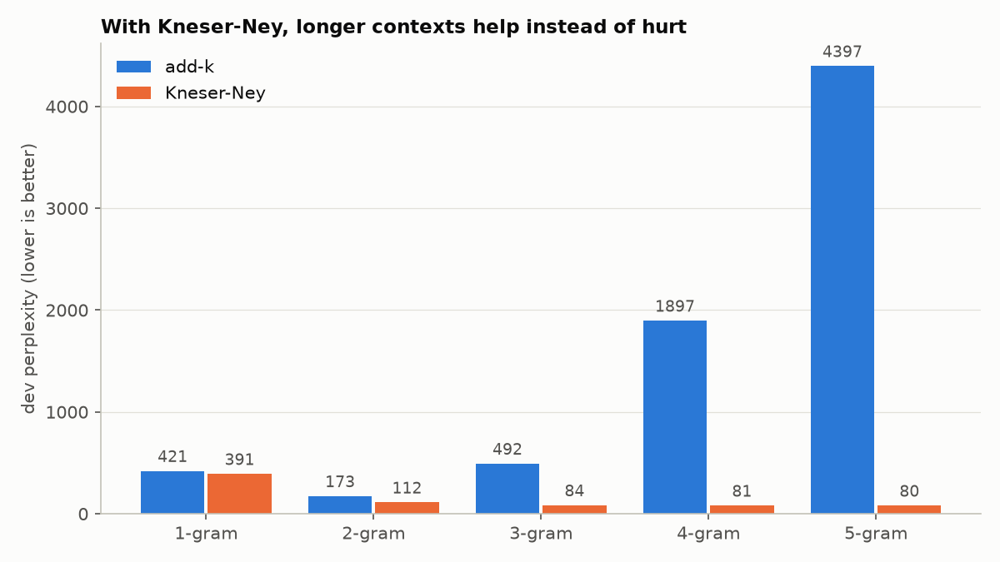

# ICS554 Prosit 1 — Section B: an n-gram language model for Twi

A statistical language model for Twi (Akan), a low-resource Ghanaian language. It
predicts the next word from the previous words. Two smoothing methods are compared:
**add-k** and **interpolated Kneser-Ney**.

## Results

Perplexity on held-out sentences (lower is better). Settings were tuned on the dev set
only; the test set was used once at the end.

| Model | Setting | Dev | Test |
|---|---|---|---|
| Add-k unigram | k = 1.0 | 421.10 | – |
| Add-k bigram | k = 0.002 | 173.44 | 175.27 |
| Add-k trigram | k = 0.001 | 492.45 | – |
| Kneser-Ney bigram | d = 0.8 | 111.71 | – |
| Kneser-Ney trigram | d = 0.85 | 84.38 | – |
| Kneser-Ney 4-gram | d = 0.9 | 80.55 | – |
| **Kneser-Ney 5-gram** | **d = 0.9** | **80.46** | **80.14** |

With add-k, models longer than a bigram get *worse* because most longer word sequences
are never seen in training and add-k spreads probability evenly over all 27,659 words.
Kneser-Ney backs off to shorter contexts instead, so longer contexts help, and it more
than halves the perplexity of the best add-k model.



## Data

`twi_sentences.txt` — 79,655 Twi sentences, one per line (about 1.13 million words).
After lowercasing, removing punctuation and removing duplicates: 79,550 sentences and
31,056 different words, 52% of which appear only once.

Source: the text transcripts of [`ghananlpcommunity/twi-tts-asr`](https://huggingface.co/datasets/ghananlpcommunity/twi-tts-asr)
on Hugging Face (GhanaNLP community), licensed CC BY-NC 4.0 (non-commercial use only).

Split (shuffled with seed 42): 80% train (63,640), 10% dev (7,955), 10% test (7,955).

## How to run

The notebook reads `twi_sentences.txt` from the same folder. If the file isn't there
(e.g. on Google Colab), it mounts Google Drive and reads it from
`MyDrive/Ashesi/ICS554_Prosit1/`.

Locally:

```bash
pip install matplotlib numpy jupyter
jupyter notebook Nlp_Prosit1_Twi.ipynb
```

Run all cells top to bottom (takes about 3 minutes). Figures are written to `figures/`.

## What's in the notebook

| Steps | What they do |
|---|---|
| 1–3b | Load, inspect and clean the data; word-frequency plots |
| 4 | Train / dev / test split |
| 5–7 | Count n-grams, predict the next word, add-k smoothing |
| 8–9b | Tune k on dev; compare unigram to 5-gram with add-k |
| 10 | Kneser-Ney smoothing, with a check that probabilities sum to 1 |
| 11–11b | Tune d and n for Kneser-Ney; compare with add-k |
| 12 | Next-word predictions and sentences generated by the best model |
| 13 | Final evaluation on the test set |
