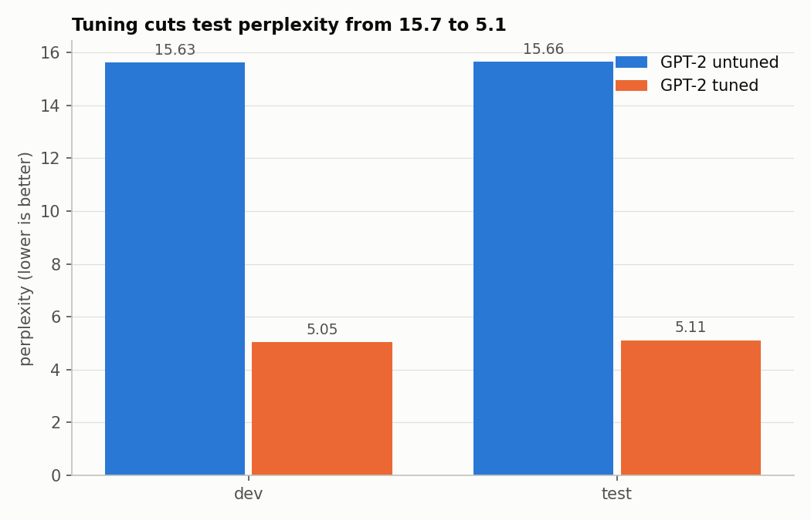
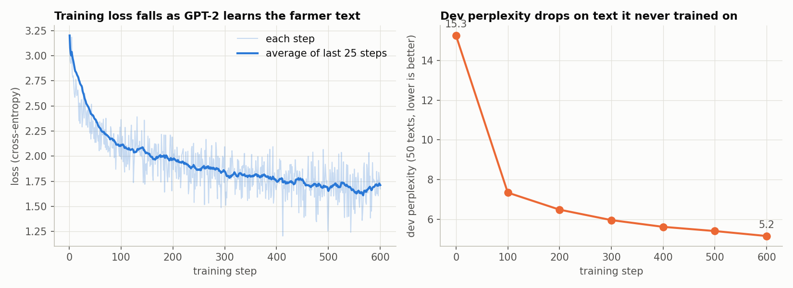

# ICS554 Prosit 1 — Section C: GPT-2 tuned to the agriculture domain

GPT-2 (small, 124M parameters) fine-tuned on Kenyan farmer questions and answers, so it
models agricultural English better than the general-purpose model.

## Results

Perplexity (lower is better), measured on every held-out dev (681) and test (682) text.

| Model | Dev | Test |
|---|---|---|
| GPT-2 untuned | 15.63 | 15.66 |
| **GPT-2 tuned** | **5.05** | **5.11** |

Tuning cuts perplexity by about two thirds. Dev and test are almost the same, so the
model is not just memorising the training data.

The model was checked on 50 dev texts every 100 steps while training. Dev perplexity
fell steadily (15.25 → 7.35 → 6.49 → 5.97 → 5.63 → 5.42 → 5.17) and training loss fell
from 3.20 to 1.69 (average of the last 50 steps).

Given the same prompt and random seed, the untuned model drifts off topic, while the
tuned model writes in the dataset's style and sets the answer in Kenya:

> **Prompt:** My maize leaves are turning yellow. What should I
>
> **Untuned:** …do?" "I will make a statement, but don't panic. I'm here for you. You
> are a human being and I am here to make you a better one.
>
> **Tuned:** …do about this? Hello there! It's great to hear from you. Let's talk about
> your maize leaves turning yellow. This is a common concern, especially given the short
> rainfall season.

All samples and numbers are in [`section_c_results.txt`](section_c_results.txt).

## Data

[`DigiGreen/farmerchat-queries`](https://huggingface.co/datasets/DigiGreen/farmerchat-queries),
Kenya subset: 6,815 farmer questions with answers (about 2.3 million words). Each
question and its answer are joined into one text.

Split (shuffled with seed 42): 80% train (5,452), 10% dev (681), 10% test (682).

## Training

Full fine-tuning of GPT-2 small: 600 steps, batch size 4, max length 256 tokens,
AdamW, learning rate 5e-5, on a free Google Colab Tesla T4 GPU. Padding tokens are
excluded from the loss. Every 100 steps the model is checked on 50 dev texts it never
trains on, to confirm it is learning and not just memorising.

## How to run

Open `NLP_Task2_domain_model.ipynb` in Google Colab with a GPU runtime and run all cells.
The dataset downloads from Hugging Face. Results and figures are saved to Google Drive under
`MyDrive/Ashesi/ICS554_Prosit1_TaskC/`; copies are in this folder.

Requirements: `torch`, `transformers`, `datasets` (all preinstalled on Colab).
